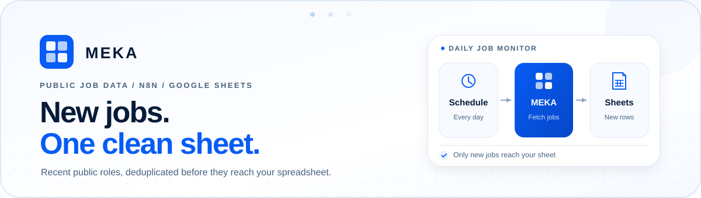

<p align="center">
  
</p>

<h1 align="center">LinkedIn Jobs Scraper &amp; Daily Job Monitor for n8n</h1>

<p align="center">
  Stop checking LinkedIn manually. Save matching jobs to Google Sheets daily, skip duplicates, and keep your first-seen history.
</p>

<p align="center">
  <a href="https://raw.githubusercontent.com/meka-im/linkedin-jobs-scraper-examples/main/n8n/linkedin-jobs-to-google-sheets.json">
    
  </a>
  <a href="https://sheets.google.com/create">
    
  </a>
  <a href="https://apify.com/meka.im/linkedin-jobs-scraper">
    
  </a>
</p>

<p align="center">
  <a href="#one-command-start">One-command start</a> &middot;
  <a href="#manual-or-n8n-cloud-import">Import</a> &middot;
  <a href="#how-it-works">How it works</a> &middot;
  <a href="#api-examples">API examples</a> &middot;
  <a href="#documentation">Documentation</a>
</p>

<p align="center">
  <strong>Start locally or import for Cloud &rarr; connect your accounts &rarr; test &rarr; enable.</strong>
  <a href="docs/setup.md">Setup guide</a><br>
  <sub>Node.js API, local n8n lifecycle, and two-run n8n Cloud execution are tested. The submission passed AI review and entered human review. The official Cloud one-click button is pending the typical 3–5 business-day review; no public template URL exists yet.</sub>
</p>

## Why this workflow

- **Daily schedule with an explicit timezone.** A manual trigger makes setup testable. The included Schedule Trigger is set to **08:00** but stays inactive. Before enabling it, explicitly choose the workflow timezone and verify what 08:00 means in that timezone.
- **Incremental by design.** Each run searches a recent window, deduplicates by LinkedIn job `id`, and appends only unseen rows.
- **Stable first-seen data.** Existing rows are not rewritten, so `firstSeenAt` remains the timestamp when that job first entered your sheet.
- **Small dependency surface.** The workflow uses built-in n8n nodes. It uses no LLM and no third-party npm packages.

## How it works

<p align="center">
  
</p>

**Schedule -> MEKA -> validate `OUTPUT` -> fetch one batch -> read existing IDs -> append new rows.**

The workflow checks the Actor's `OUTPUT` counters before accepting Dataset items. A clean empty batch means no new IDs were found in that fetched batch; it does not imply full-market coverage.

## One-command start

The commands below use the official GitHub source-package specifier. You do not need to clone the repository, change directory, or install project dependencies first.

### API only: save jobs as JSON

Requires **Node.js 22 or newer**.

```bash
npx --yes --package=github:meka-im/linkedin-jobs-scraper-examples meka-jobs
```

The default command calls the MEKA Actor with the included London `software engineer`, `pastWeek`, 10-result demo and writes the public job records to `./jobs.json`. Before the first paid request, it explains the USD 0.05 hard Actor charge cap and asks for confirmation. If `APIFY_TOKEN` is not already in the environment, an interactive terminal asks for it with echo disabled.

Use `--input <file>` for another Actor input, `--output <file>` for another result path, and `meka-jobs --help` for all options. `meka-jobs --check` reports the Node.js and token configuration without making a network request; a missing token makes the check exit nonzero.

The two `--yes` flags have different scopes:

- `npx --yes` only answers npm's package-install confirmation.
- `meka-jobs --yes` explicitly accepts the Apify request and charge cap for non-interactive use.
- `--overwrite` is a separate explicit authorization required to replace an existing output file. `--yes` does not imply `--overwrite`.

For unattended API runs, put `APIFY_TOKEN` in the environment using your shell or secret manager, then run the same command with `meka-jobs --yes`. Do not put a real token in a command copied into documentation, an issue, or a screenshot.

### Local visual n8n with the workflow pre-imported

Requires **Node.js 22 or newer** and a running **Docker Desktop or Docker Engine**.

```bash
npx --yes --package=github:meka-im/linkedin-jobs-scraper-examples meka-jobs n8n
```

The command uses the pinned official image `docker.n8n.io/n8nio/n8n:2.44.6`, publishes only `127.0.0.1:5678`, keeps n8n data in a dedicated Docker volume, and imports the bundled inactive workflow once. It waits for n8n readiness before printing `http://localhost:5678`. Use `--port <port>` if 5678 is unavailable.

After the URL opens, complete these one-time app steps in n8n:

1. Create the n8n owner account.
2. Connect the workflow's Apify HTTP Header Auth and Google Sheets OAuth2 credentials.
3. Select your own spreadsheet and complete the documented header/settings setup.
4. Open **Workflow settings -> Timezone**, choose UTC or your local timezone, and verify the Daily Schedule's 08:00 meaning.
5. Run the workflow manually and inspect both n8n and the sheet.
6. Activate the schedule only after that test succeeds.

The workflow arrives inactive. The command does not inject credentials, activate the schedule, or start a paid Actor execution.

Stop it without deleting its persistent data:

```bash
docker stop meka-linkedin-jobs-n8n
```

Resume by running the same `meka-jobs n8n` command again. The command restarts the stopped MEKA container and keeps the dedicated `meka-linkedin-jobs-n8n-data` volume. It does not provide an automatic cleanup or volume-deletion step.

Stop/start and error recovery preserve data while the pinned image and bundled workflow baseline match. The command does **not** automatically upgrade n8n or re-import a changed workflow. If the workflow baseline differs, it stops with a migration-required error rather than modifying or clearing the existing volume.

### Current release checks

On 2026-10-25, the fixed Node.js 22 suite passed **70 Node.js tests and 4 Python tests (74 total)**, including structural checks for the template submission variant. An `npm pack` artifact contained **8 files**, and its CLI loaded successfully with an empty npm cache from a new working directory whose path contained spaces. The same packed CLI completed the live 10-result API demo with 10 unique jobs, `coverage: "complete"`, all failed-job/search/company counters at zero, and `stoppedByBudget: false`. The packed local n8n path also passed first startup, reuse of the running container, and restart of a stopped container from a fresh empty npm cache. These are acceptance results for one release snapshot, not latency or market-coverage promises.

On n8n Cloud 2.45.3 Experimental, two Manual Trigger executions also completed with the schedule inactive and Execution Logic set to `v1` (recommended). Both runs used the unchanged public workflow, completed with `coverage: "complete"`, reported zero failed searches, failed job details, and failed companies, and did not stop by budget. The real sheet moved from 0 to 10 to 11 rows, with 11 unique IDs and no duplicates. The two Manual Trigger runs used the instance's default timezone; after those runs, the private workflow's Settings timezone was explicitly changed to `Etc/UTC`, saved, reopened, and confirmed while the schedule remained inactive. See [the current acceptance measurements](validation/2026-10-25/one-command-acceptance.json).

## Manual or n8n Cloud import

1. **Import the workflow.** In n8n, choose **Import from URL** and paste the [raw workflow JSON](https://raw.githubusercontent.com/meka-im/linkedin-jobs-scraper-examples/main/n8n/linkedin-jobs-to-google-sheets.json). Alternatively, download the file and choose **Import from File**. Keep it inactive. See [n8n's import guide](https://docs.n8n.io/build/manage-workflows/export-and-import.md).

2. **Connect two accounts.** For Apify, create an **HTTP Header Auth** credential with name `Authorization` and value `Bearer <YOUR_APIFY_TOKEN>`, then select it on **Start Actor**, **Poll Actor Run**, **Get Run Output**, and **Get Dataset Items**. For Google on n8n Cloud, create a **Google Sheets OAuth2** credential, click **Sign in with Google**, and select the same credential on **Read Existing Jobs** and **Append Rows**. Cloud managed OAuth uses your own Google authorization; the workflow contains no token or account ID.

3. **Prepare the sheet and settings.** [Create a blank spreadsheet](https://sheets.google.com/create), rename its worksheet to `Jobs`, and paste the tab-separated header below into cell **A1**. Open **Search settings**, enter the spreadsheet document ID as `sheetId`, keep `sheetName` as `Jobs`, and set your keywords, location, date window, result limit, and spending cap.

4. **Set timezone, test, then activate.** In **Workflow settings -> Timezone**, choose `Etc/UTC` or your own local timezone, then verify what the Daily Schedule's **08:00** means. Imports may use the n8n instance default even when the JSON declares UTC. Run the workflow manually and check both the n8n execution and the actual sheet. Activate the schedule only after that succeeds.

**Copy this tab-separated header after opening the [TSV file](sheets/jobs-header.tsv):**

```tsv
id	title	company	location	postedAt	url	salary	employmentType	seniority	firstSeenAt
```

Paste it into **A1**. Do not paste separately comma-delimited values into A1: Google Sheets may place that text in one cell. The workflow requires these ten exact header names. This guide uses the worksheet name `Jobs`; another tab name works when `sheetName` in **Search settings** matches it. The order above is recommended, while row mapping and deduplication use the header names.

The workflow JSON imported successfully through the n8n Cloud 2.45.3 UI on 2026-10-25, Google OAuth authorization is complete, and two manual Cloud-to-Sheets executions completed. The Creator Terms were confirmed, AI review completed, and the byte-identical submission variant was re-uploaded and submitted for human review. n8n's confirmation says review typically takes **3–5 business days**. Human review is still pending, and no public template URL or official template ID has been issued. This repository therefore does not present an official one-click template button or a guessed template ID.

<details>
<summary><strong>Using self-hosted n8n?</strong></summary>

Self-hosted installations may use a custom Google OAuth2 credential instead of n8n Cloud managed OAuth. Configure the Google Sheets API and Google Drive API, create the required OAuth client in your own Google Cloud project, and complete the provider's security requirements. Do not bypass a Google OAuth warning. The full credential checklist is in [docs/setup.md](docs/setup.md#self-hosted-google-oauth).

</details>

## Deduplication and sheet safety

The workflow searches `pastWeek` so daily runs overlap, reads the current `Jobs` sheet, removes duplicate IDs within the new batch, and appends only IDs that are absent from the sheet. Existing rows are left untouched. Keep one workflow and one sheet writer per deployment; two executions reading and appending at the same time can race and create duplicates.

The append node writes cells as `RAW`, so spreadsheet formulas are not evaluated. A row containing data but no valid `id` stops the execution with an explicit error instead of being treated as empty.

## Output columns

`id`, `title`, `company`, `location`, `postedAt`, `url`, `salary`, `employmentType`, `seniority`, `firstSeenAt`

Missing optional Actor values are stored as empty strings. See [the field-by-field reference](docs/reference.md#output-columns) for sources and behavior.

## n8n Cloud acceptance evidence

Both executions used the **Manual Trigger** and left the schedule inactive. They used the same public workflow SHA-256 and private Search settings overrides for `limit: 10`, `sheetName: "CloudJobs"`, `budgetUsd: 0.05`, and `scrapeCompany: false`; no private workspace, account, spreadsheet ID, or execution ID is published here.

| Run on Cloud 2.45.3 Experimental | Fetched | Existing IDs skipped | Appended | Sheet rows |
| --- | ---: | ---: | ---: | ---: |
| First run | 10 | 0 | 10 | 0 -> 10 |
| Second run | 10 | 9 | 1 | 10 -> 11 |

Both runs reported `coverage: "complete"`, zero failed searches, zero failed job details, zero failed companies, and `stoppedByBudget: false`. The final sheet had **11 unique IDs and 0 duplicates**. Independent readback confirmed that all ten rows from the first run retained all ten fields and their original `firstSeenAt` values.

Read the [current sanitized measurements](validation/2026-10-25/one-command-acceptance.json), the [historical local n8n measurements](validation/2026-10-25/n8n-sheets-acceptance.json), and the [acceptance guidance](docs/acceptance.md). These results are not a guarantee that a later run will append the same number of jobs.

## API examples

The JavaScript, Python, and cURL examples use the same sample input and only runtime or standard-library features. **Choose one command below. Each example starts its own independent Actor run, which may incur charges.**

```bash
git clone https://github.com/meka-im/linkedin-jobs-scraper-examples.git
cd linkedin-jobs-scraper-examples
export APIFY_TOKEN='<YOUR_APIFY_TOKEN>'
```

<details>
<summary><strong>JavaScript example</strong> (Node.js 22 or newer)</summary>

```bash
node examples/javascript.mjs examples/input.json jobs.json
```

</details>

<details>
<summary><strong>Python example</strong> (Python 3.10 or newer)</summary>

```bash
python3 examples/python.py examples/input.json jobs.json
```

</details>

<details>
<summary><strong>cURL example</strong> (cURL plus Python 3.10 or newer)</summary>

```bash
bash examples/curl.sh examples/input.json jobs.json
```

</details>

Each selected command writes Dataset items to `jobs.json`. Change [examples/input.json](examples/input.json) to use another search. The complete polling, `OUTPUT`, validation, and failure behavior is in [the technical reference](docs/reference.md#api-request-sequence).

## FAQ

- **Does this cover every LinkedIn job in a market?** No. Results are bounded by the Actor input, public availability, search ranking, enrichment outcomes, and spending cap. Use focused searches for broader practical coverage.
- **Is importing the JSON enough?** No. You still supply Apify and Google credentials, create the exact `Jobs` sheet, choose search settings, and test before activation.
- **Where do keys and Google access live?** In your n8n credentials. The [workflow JSON](n8n/linkedin-jobs-to-google-sheets.json) and repository contain no token, account name, or spreadsheet ID. MEKA does not receive access to your Google credentials.
- **Is it free?** The example code is MIT licensed, but Apify and n8n may charge for their services. Check current [Actor pricing](https://apify.com/meka.im/linkedin-jobs-scraper) and [n8n pricing](https://n8n.io/pricing/).

## Documentation

- [Setup guide](docs/setup.md): one-command API and local n8n startup, manual/Cloud import, credentials, sheet creation, test, and troubleshooting.
- [Technical reference](docs/reference.md): request sequence, polling, result semantics, failures, security, and tests.
- [Acceptance notes](docs/acceptance.md): evidence scope and maintenance rules.
- [n8n template submission notes](docs/n8n-template-submission.md): maintainer copy for Creator submission, review, and release gating.
- [Sanitized one-command and Cloud measurements](validation/2026-10-25/one-command-acceptance.json): current machine-readable 2026-10-25 results.
- [Historical local n8n measurements](validation/2026-10-25/n8n-sheets-acceptance.json): earlier local 2.44.6 results.
- [Workflow JSON](n8n/linkedin-jobs-to-google-sheets.json): inactive, credential-free n8n import.
- [Template submission variant](n8n/linkedin-jobs-to-google-sheets-template.json): the same executable workflow with the review-ready title and expanded setup sticky.
- [Repository tests](tests/): offline mocks for the API examples and embedded n8n Code nodes.

The exported workflow SHA-256 is `8823e9720a601683197fff35a30586343f58632515e1854d7f13cd417f2299ac`.

<p align="center">
  Built by <a href="https://meka.im">MEKA</a> &middot;
  <a href="https://github.com/meka-im/linkedin-jobs-scraper-examples">Official repository</a> &middot;
  <a href="https://github.com/meka-im/linkedin-jobs-scraper-examples/issues">Issues</a> &middot;
  <a href="LICENSE">MIT License</a>
</p>
