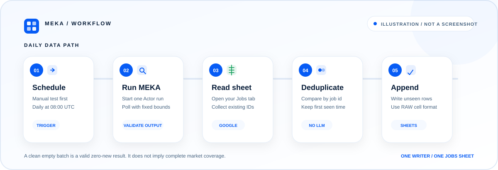

# Technical reference

This document describes the request contract, n8n workflow behavior, result semantics, failure modes, test evidence, and operational limits for the LinkedIn Jobs examples. For a Cloud-first walkthrough, start with the [setup guide](setup.md).

## Repository contents

| Path | Purpose |
| --- | --- |
| [`n8n/linkedin-jobs-to-google-sheets.json`](../n8n/linkedin-jobs-to-google-sheets.json) | Inactive n8n workflow with manual and daily triggers, using built-in nodes. |
| [`examples/input.json`](../examples/input.json) | One structured Actor input shared by all API examples. |
| [`examples/javascript.mjs`](../examples/javascript.mjs) | Node.js 22+ example using built-in `fetch`. |
| [`examples/python.py`](../examples/python.py) | Python 3.10+ standard-library example. |
| [`examples/curl.sh`](../examples/curl.sh) | cURL example using Python only for JSON handling. |
| [`sheets/jobs-header.tsv`](../sheets/jobs-header.tsv) | Tab-separated Google Sheets header intended for a direct A1 paste. |
| [`tests/`](../tests/) | Offline API mocks, workflow export checks, and embedded Code-node tests. |
| [`docs/acceptance.md`](acceptance.md) | Scope and maintenance rules for the live acceptance evidence. |
| [`validation/2026-10-25/n8n-sheets-acceptance.json`](../validation/2026-10-25/n8n-sheets-acceptance.json) | Sanitized machine-readable measurements from the 2026-10-25 runs. |

The workflow is not a hosted service, an n8n template-library listing, or a one-click deployment. The exported file is intended to be imported into a user's n8n workspace and configured with that user's credentials and sheet.

## Compatibility and evidence boundaries

- The workflow uses built-in n8n nodes and was functionally exercised on **n8n 2.44.6**.
- The two complete n8n-to-Google-Sheets acceptance runs were executed on local n8n 2.44.6, not n8n Cloud.
- n8n supports importing a workflow JSON from a URL or file. Import compatibility does not establish that every Cloud deployment has completed an end-to-end run.
- API-only checks, offline mocks, and Code-node smoke runs are not counted as additional Google Sheets end-to-end results.
- Use the current [Actor page](https://apify.com/meka.im/linkedin-jobs-scraper) for input fields and billing information.

## Workflow architecture

<p align="center">
  
</p>

The diagram is an explanatory illustration, not a product screenshot.

The exported workflow connects these stages:

1. **Manual Trigger** supports a supervised first run.
2. **Daily Schedule** is configured for 08:00 UTC but starts only after workflow activation.
3. **Search settings** stores the non-secret search and sheet configuration.
4. **Input Validation** rejects missing, unsupported, or unsafe configuration before an Actor start.
5. **Start Actor** sends one `POST` and receives a run ID, status, and Dataset ID.
6. READY or RUNNING responses pass through a bounded wait and poll loop.
7. **Get Run Output** reads the Actor's `OUTPUT` summary before Dataset items are accepted.
8. **Get Dataset Items** retrieves one bounded JSON batch.
9. **Normalize Jobs** validates each public job and creates the ten-column row shape.
10. **Read Existing Jobs** reads the current `Jobs` worksheet.
11. **Filter New IDs** compares the fetched IDs with existing IDs and removes duplicate IDs inside the new batch.
12. **Append Rows** writes only unseen jobs with the fixed ten-column schema.
13. **Run Summary** reports the fetched, new, appended, and skipped counts with coverage status.

The exported workflow is inactive and contains no credential IDs, API token, OAuth state, account name, spreadsheet ID, Actor run ID, or Dataset ID.

## Configuration contract

The exported **Search settings** node supplies these fields:

| Field | Validation or behavior |
| --- | --- |
| `keywords` | Required non-empty string. |
| `location` | Required non-empty string. |
| `datePosted` | Must be one of `anyTime`, `past24Hours`, `pastWeek`, or `pastMonth`. |
| `limit` | Integer from 1 through 1000. Used as both `count` and `limitPerSource` in the Actor input. |
| `budgetUsd` | Finite number greater than zero. Passed as the Actor maximum charge parameter. |
| `scrapeCompany` | Boolean; only `true` enables the corresponding Actor input. The exported value is `false`. |
| `sheetId` | Required Google Sheets document ID matching `[A-Za-z0-9_-]{2,}`. |
| `sheetName` | Required non-empty worksheet name. The documented name is `Jobs`. |

`limit` is a cap, not a guarantee of total market coverage. Search rankings, public availability, enrichment failures, and the spending cap can reduce delivered jobs. For broader practical coverage, use smaller targeted searches and an intentional budget rather than expecting one query to be exhaustive.

Input Validation derives these execution controls:

| Control | Exported value |
| --- | ---: |
| Actor timeout | 300 seconds |
| Start request wait-for-finish window | 60 seconds |
| Poll delay | 5 seconds |
| Maximum polls | 6 |
| Overall local run deadline | 480 seconds from input validation |

The HTTP Request nodes allow up to 70 seconds for an individual request. These values bound the example; they do not promise a universal latency.

## API request sequence

The JavaScript, Python, and cURL examples implement the same sequence:

1. Send one `POST` to start `meka.im~linkedin-jobs-scraper` with `memory=512`, `timeout=300`, `maxTotalChargeUsd=0.05`, and `waitForFinish=60`.
2. Poll the started run at most six times while its status is READY or RUNNING. The start `POST` is never retried automatically, which avoids accidentally starting and charging for another run.
3. Accept only SUCCEEDED. FAILED, TIMED-OUT, and ABORTED fail explicitly.
4. Read the run's `OUTPUT` summary before the Dataset.
5. Fail if `failedSearches > 0`. Mark `failedJobDetails > 0`, `failedCompanies > 0`, or `stoppedByBudget: true` as partial coverage.
6. For a successful run with no failed searches, fetch the Dataset with `format=json`, `clean=true`, and the requested count. The API examples validate that every item has a numeric `id`, a non-empty `title`, and an HTTPS public `linkedin.com` `/jobs/view/` URL. They do **not** compare the URL's terminal numeric job ID with `item.id`. Strict URL-path ID matching is performed by the n8n **Normalize Jobs** and **Filter New IDs** nodes, not by the standalone API examples.

A clean empty Dataset is a successful zero-item result for that fetched batch. It does not imply that the search covered every matching public job. An empty Dataset is not considered clean when the Actor summary reports failed searches, failed details, failed companies, or a budget stop.

If polling reaches its limit or deadline, the error includes the run ID so the started run can be inspected in Apify. A network failure before the run ID is received cannot return an ID that was never received. Start a recovery run deliberately; the examples do not create one automatically.

## API examples

The examples require:

- Node.js 22 or newer for `examples/javascript.mjs`.
- Python 3.10 or newer for `examples/python.py`.
- cURL and Python 3.10 or newer for `examples/curl.sh`.

Each example reads `examples/input.json`, sends `Authorization: Bearer $APIFY_TOKEN`, and writes Dataset items to the requested local file, commonly `jobs.json`. The token is not placed in a query string or printed by the examples.

The sample searches for `software engineer` in `London, United Kingdom`, limited to jobs posted in the past week. Change the input to use another supported search.

Both `count` and `limitPerSource` are caps. A result count cannot be used as evidence of universal market coverage.

## Output and coverage semantics

The Actor writes an `OUTPUT` summary for every run. The workflow reads it before accepting Dataset items:

- Any failed search fails the workflow. The default template uses one search, so a failed search is not reported as a clean zero-new result.
- Failed job details, failed company enrichment, or a budget stop produces partial coverage.
- Only a run with zero failed searches and no partial-coverage indicators is complete.
- A clean empty Dataset is then a normal zero-new result for that fetched batch.
- `cacheHits` is recorded in the summary. The template does not control or promise Actor cache behavior.

A partial result can still be appended because it contains valid delivered jobs. **Run Summary** includes a warning that does not establish an empty market. Inspect the execution before deciding whether a changed query or budget is appropriate.

## Deduplication and sheet behavior

The workflow uses `pastWeek` in the exported settings so consecutive daily runs overlap. Deduplication has two levels:

1. It reads the `id` column from the current `Jobs` sheet and skips any fetched ID already present.
2. It tracks IDs seen inside the current fetched batch and keeps the first occurrence of each ID.

Only unseen jobs are appended. Existing rows are not updated, so each row's `firstSeenAt` remains the timestamp when that workflow first inserted it. The Normalize Jobs node calculates one ISO timestamp for the current batch.

The **Read Existing Jobs** node has `Always Output Data` enabled so an empty sheet can still reach the deduplication Code node. A truly empty output placeholder is ignored. A non-empty existing row without a valid `id` fails explicitly instead of being treated as an empty sheet.

The append node uses a fixed resource-mapper schema for these ten headers:

`id`, `title`, `company`, `location`, `postedAt`, `url`, `salary`, `employmentType`, `seniority`, `firstSeenAt`

A renamed or missing required header is rejected before rows are written. The recommended order is used for setup, but deduplication and row mapping do not depend solely on column ordering.

The append node sets `cellFormat` to RAW. Titles, salaries, URLs, and other text are therefore written as values instead of being interpreted as spreadsheet formulas.

Use one workflow and one writer per initial deployment. Do not run multiple workflows against the same `Jobs` sheet concurrently: separate read-then-append executions can race and append the same unseen ID.

## Output columns

| Column | Source and behavior |
| --- | --- |
| `id` | Public LinkedIn job ID. The n8n workflow requires a numeric ID that matches the numeric ID at the end of the public job URL. |
| `title` | Public job title; required for a valid item. |
| `company` | Public company name when available. |
| `location` | Public location when available. |
| `postedAt` | Public posting date when available. |
| `url` | Public LinkedIn job URL in `/jobs/view/` form; required for a valid item. |
| `salary` | Public salary text when available. |
| `employmentType` | Public employment type when available. |
| `seniority` | Public seniority when available. |
| `firstSeenAt` | ISO timestamp shared by the new rows inserted in that batch. |

Missing optional Actor values are stored as empty strings.

## Failure behavior

- A start request, status poll, `OUTPUT` request, Dataset request, sheet read, or sheet append error fails the execution. A failed operation is not counted as a zero-new result.
- READY and RUNNING continue through a bounded poll loop. The loop fails when its poll count or deadline is exhausted and includes the run ID in the error.
- An incorrect or missing sheet schema fails at the append node before rows are written.
- A successful Actor run with failed searches fails before Dataset processing.
- A malformed Dataset item, mismatched job ID, non-HTTPS URL, non-LinkedIn authority, or malformed `/jobs/view/` path fails normalization.
- A row with existing sheet data but no valid `id` fails before append.

Recovery must account for the possibility that the original Actor run already started. Do not blindly repeat a start `POST`.

## Schedule and activation

The Schedule Trigger runs daily at **08:00 UTC** once the workflow is active. Change the workflow timezone or trigger hour if that is not the intended local time.

The Manual Trigger remains useful for supervised tests after an import or configuration change. Importing and saving the workflow do not activate the schedule, and the exported file is explicitly inactive.

Active executions consume Apify resources according to the current Actor and account terms. This repository makes no price promise.

## Tests and historical evidence

Run the offline suite from the repository root:

```bash
npm test
```

The suite requires Node.js 22 or newer and Python 3.10 or newer. It starts loopback-only mock HTTP servers and does not call Apify or Google. It executes the JavaScript embedded in the exported n8n Code nodes with mocked n8n inputs, checks the exported workflow for embedded credentials and unsafe retry settings, exercises the sample request sequence, and verifies that invalid input makes no start `POST`.

The 2026-10-25 acceptance notes record a historical pass of 36 Node tests and 4 Python tests. That **40-test offline result verifies the existing suite at that point**; it is not an additional live Google Sheets end-to-end run.

[`tests/fixtures/n8n-code-smoke.workflow.json`](../tests/fixtures/n8n-code-smoke.workflow.json) is a credential-free fixture for executing the embedded Code nodes in a separate real n8n instance. Its documented expected result is:

- `status: "passed"`
- `pollCount: 2`
- `splitItemCount: 2`
- `normalizedCount: 2`
- `urlGlobalType: "undefined"`

The `urlGlobalType` value records the internal Code sandbox behavior that the embedded validators intentionally handle: the standard `URL` global is `undefined` in that execution context. The acceptance evidence records this real-engine Code-node smoke check alongside, but separate from, the two complete n8n and Google Sheets runs.

The current complete acceptance evidence is two sequential runs on 2026-10-25 with distinct live Actor runs:

- Run 1 fetched 10 jobs and appended 10 rows to an empty sheet.
- Run 2 fetched 10 jobs, skipped 9 existing IDs, and appended 1 row.
- The final sheet had 11 unique IDs and 0 duplicate IDs.
- The original 10 rows, including their `firstSeenAt` values, remained unchanged.

See [Acceptance Notes](acceptance.md) and the [sanitized JSON measurements](../validation/2026-10-25/n8n-sheets-acceptance.json). The later run's one appended row is evidence about that batch, not a guarantee that another run will append the same number.

## Rebuilding the exported workflow

When intentionally editing source under `n8n/code/`, an authorized maintainer must rebuild the exports before testing:

```bash
npm run build:workflow
```

The current exported workflow SHA-256 is:

```text
8823e9720a601683197fff35a30586343f58632515e1854d7f13cd417f2299ac
```

Treat that hash as the identity of the current evidence snapshot. A later intentional source or workflow change must produce new measurements rather than rewriting the dated 2026-10-25 evidence.

## Scope and security

This initial template is not designed for high concurrency, full-market coverage, or multi-writer coordination. It does not use an LLM, send social messages, or modify the Actor.

Keep API and OAuth tokens in n8n credentials. Do not commit `.env`, `jobs.json`, credential exports, execution payloads, account IDs, spreadsheet IDs, or other private execution data. Public validation files must remain sanitized.

The workflow and examples use public job data. Follow applicable laws and LinkedIn's terms.

## License

MIT. See [LICENSE](../LICENSE).
