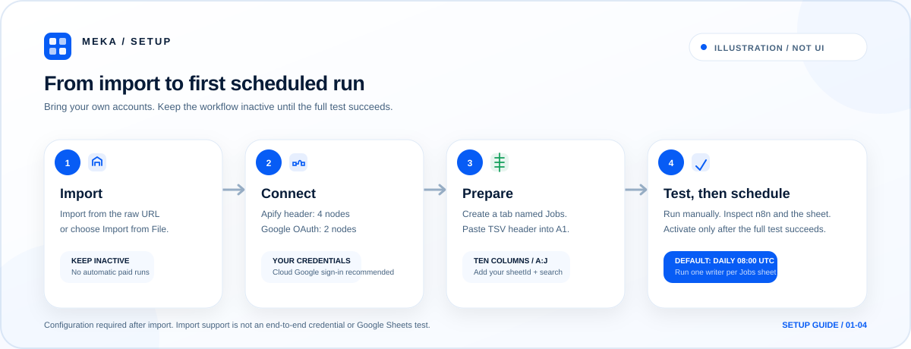

# Setup guide

This guide covers the one-command API and local n8n paths, plus the manual n8n Cloud or self-hosted import path. The workflow is inactive after import and contains no credentials, account names, or spreadsheet IDs.

<p align="center">
  
</p>

The setup image is an illustration, not a screenshot of the current n8n interface.

## Choose a path

| Goal | Start with | Requirements |
| --- | --- | --- |
| Run the Actor and save public jobs as JSON | `meka-jobs` | Node.js 22 or newer |
| Open a local visual n8n with the workflow pre-imported | `meka-jobs n8n` | Node.js 22 or newer and a running Docker daemon |
| Use n8n Cloud or another existing n8n workspace | Manual **Import from URL** | n8n access plus Apify and Google accounts |

The commands in this section use the official GitHub source-package specifier and require no prior clone, change directory, or npm dependency install.

## API only from one command

Requires **Node.js 22 or newer**.

```bash
npx --yes --package=github:meka-im/linkedin-jobs-scraper-examples meka-jobs
```

The default input is the included London `software engineer`, `pastWeek`, 10-result demo. Results are written to `./jobs.json`. Before the first paid request, the CLI shows the request plan and the Actor's **USD 0.05 hard maximum charge** and asks for confirmation.

If `APIFY_TOKEN` is missing, an interactive terminal asks for the token without echoing it. The token is retained in memory for the request; it is not placed in command arguments, URLs, logs, or the output file.

Useful options:

| Option | Behavior |
| --- | --- |
| `--input <file>` | Read another Actor input JSON file. |
| `--output <file>` | Write somewhere other than `./jobs.json`. |
| `--check` | Check Node.js and token configuration without network access. A missing token exits nonzero. |
| `--help` | Print usage without requiring a token or calling the network. |
| `--yes` | Accept the displayed Apify request and charge cap for a non-interactive run. |
| `--overwrite` | Explicitly allow replacing an existing output file after a successful run. |

`npx --yes` only accepts npm's package-install confirmation. It does **not** accept the Apify charge. `meka-jobs --yes` is the separate API authorization. `--overwrite` is a third, independent decision: neither `--yes` flag authorizes replacing an existing result file.

For unattended use, place `APIFY_TOKEN` in the environment through your shell or secret manager and add `meka-jobs --yes`. Do not put a real token into documentation, chat, repository files, or screenshots.

## Local n8n from one command

Requires **Node.js 22 or newer** and Docker Desktop or Docker Engine with an accessible daemon.

```bash
npx --yes --package=github:meka-im/linkedin-jobs-scraper-examples meka-jobs n8n
```

The command:

- Uses the pinned official image `docker.n8n.io/n8nio/n8n:2.44.6`.
- Creates the dedicated container `meka-linkedin-jobs-n8n` and volume `meka-linkedin-jobs-n8n-data`.
- Publishes only `127.0.0.1:5678`, avoiding a network-wide listener.
- Runs n8n as the image's `node` user.
- Copies the bundled public workflow into the container and imports it once before starting n8n.
- Waits for the local readiness endpoint before printing the browser URL.

Use `--port <port>` to choose another loopback port from 1 through 65535. The printed browser URL is `http://localhost:<port>`.

Finishing setup still requires two kinds of user decisions: setting the n8n owner account and connecting external services. After the URL opens:

1. Complete n8n owner account initialization.
2. Connect the workflow's Apify HTTP Header Auth credential.
3. Connect Google Sheets OAuth2 and select your own spreadsheet.
4. Configure the `Jobs` sheet and workflow settings using the sections below.
5. In **Workflow settings -> Timezone**, choose UTC or your local timezone and verify what the Daily Schedule's 08:00 means.
6. Run the workflow manually and inspect the n8n execution and sheet.
7. Activate the included schedule only after the manual test succeeds.

The bundled workflow is inactive. The command does not inject credentials, activate its Schedule Trigger, or start an Actor run.

### Stop, resume, and persistence

Stop the container without deleting its data:

```bash
docker stop meka-linkedin-jobs-n8n
```

Resume by running the same one-command n8n command again. When the MEKA-owned container is stopped, the CLI copies the current bundled public workflow into the container and runs `docker start`; it reuses the dedicated data volume and does not clear it.

The packed CLI has been exercised through first startup, reuse of the running container, and restart of a stopped container from a fresh empty npm cache. Workflow-marker and resource-shape tests enforce the one-time import boundary.

Stop/start, repeated invocation, and CLI errors preserve data while the pinned image and bundled workflow baseline match. The CLI does **not** automatically upgrade the image or re-import a changed workflow. If the workflow hash baseline changes, it refuses automatic migration and leaves the existing container and volume in place. Complete an explicit, reviewed migration for a deliberate baseline change.

If a fixed resource name already belongs to a non-MEKA container or volume, the CLI reports the collision and does not stop, take over, or delete that resource.

This guide intentionally gives no volume-removal command. A named volume can contain the user's n8n workflows, credentials metadata, and execution history.

## What you need

Every path that executes the workflow needs the Apify and Google accounts below. The manual or Cloud import path also needs an existing n8n workspace and the workflow JSON or URL.

- An [n8n Cloud](https://n8n.io/cloud/) account, or a compatible self-hosted n8n installation. The workflow has completed end-to-end runs on local n8n **2.44.6** and n8n Cloud **2.45.3 Experimental**.
- An Apify account and API token for the [MEKA LinkedIn Jobs Scraper](https://apify.com/meka.im/linkedin-jobs-scraper).
- A Google account that can create a spreadsheet and authorize Google Sheets access.
- The [workflow JSON](../n8n/linkedin-jobs-to-google-sheets.json) or its [raw download URL](https://raw.githubusercontent.com/meka-im/linkedin-jobs-scraper-examples/main/n8n/linkedin-jobs-to-google-sheets.json).

Import compatibility, Cloud support, and an end-to-end acceptance run are different kinds of evidence. The workflow JSON imported successfully through the n8n Cloud **2.45.3 Experimental** UI on 2026-10-25, and Google OAuth authorization is complete. Two Manual Trigger executions then completed with the schedule inactive and Execution Logic set to `v1` (recommended): 10 fetched and appended in run 1, then 10 fetched, 9 existing IDs skipped, and 1 appended in run 2. The real sheet moved from 0 to 10 to 11 rows with 11 unique IDs and no duplicates. Both runs had complete coverage, all Actor failure counters were zero, and neither stopped by budget. Those Manual Trigger runs used the instance's default timezone; after the runs, the private workflow's Settings timezone was explicitly changed to `Etc/UTC`, saved, reopened, and confirmed with the schedule still inactive.

The n8n Creator account is registered and logged in. The user confirmed the Creator Terms, completed the Finalize form, re-uploaded the byte-identical workflow variant, and submitted it for human review. n8n says review typically takes **3–5 business days**. A public template URL, official template ID, and approval are still pending. Until n8n returns an approved template, there is no official one-click template button to use or advertise. The [current sanitized measurements](../validation/2026-10-25/one-command-acceptance.json) record the local command, Cloud acceptance evidence, submission state, and timezone state separately.

## 1. Import the workflow

The repository is not presenting this file as an n8n template-library submission. Import the JSON directly into your own workspace.

1. In n8n, create a new workflow.
2. Open the workflow menu and choose **Import from URL**.
3. Paste the [raw workflow URL](https://raw.githubusercontent.com/meka-im/linkedin-jobs-scraper-examples/main/n8n/linkedin-jobs-to-google-sheets.json).
4. If your browser downloads the response instead, download [the exported JSON](../n8n/linkedin-jobs-to-google-sheets.json), then use **Import from File**.
5. Leave the workflow inactive.

The n8n documentation describes [importing workflows from a URL or file](https://docs.n8n.io/build/manage-workflows/export-and-import.md). Menu labels can vary slightly between n8n versions.

Importing the workflow does not connect accounts, create a sheet, or start paid scheduled executions.

## 2. Connect the Apify account

Create an API token in your own Apify Console. Keep the token out of the workflow JSON, query strings, chat messages, screenshots, and repository files.

1. In n8n, open **Credentials** and create an **HTTP Header Auth** credential.
2. Set **Name** to `Authorization`.
3. Set **Value** to `Bearer <YOUR_APIFY_TOKEN>`, including the word `Bearer` and one space before the token.
4. Save the credential.
5. Open each of these four HTTP Request nodes and select the same credential:
   - **Start Actor**
   - **Poll Actor Run**
   - **Get Run Output**
   - **Get Dataset Items**

The workflow reads the Apify run and Dataset through these HTTP requests. It does not store the token in an editable workflow field.

## 3. Connect Google Sheets

### Recommended: n8n Cloud managed OAuth

1. Open **Credentials** and create a **Google Sheets OAuth2** credential.
2. Click **Sign in with Google** and authorize the Google account that should own or edit the target sheet.
3. Complete any account or consent steps shown by n8n Cloud.
4. Select that credential on both **Read Existing Jobs** and **Append Rows**.

n8n documents [managed Google OAuth for Sheets](https://docs.n8n.io/integrations/builtin/credentials/google/oauth-single-service/). On n8n Cloud, the recommended managed flow does not require you to create your own Google Cloud OAuth client. Google access is authorized by you; this repository and the exported workflow contain no Google credential or account ID.

### Self-hosted Google OAuth

Use the instructions that match your n8n deployment if you operate n8n yourself. A self-hosted instance may expose a custom Google OAuth2 connection instead of managed sign-in.

1. In your own Google Cloud project, enable both the **Google Sheets API** and **Google Drive API**.
2. Create an OAuth client for the deployment and configure its consent screen.
3. Configure the redirect URI exactly as instructed by the [n8n Google credential documentation](https://docs.n8n.io/integrations/builtin/credentials/google/oauth-single-service/) and your n8n installation.
4. Create the corresponding custom OAuth2 credential in n8n.
5. Select it on **Read Existing Jobs** and **Append Rows**.
6. Complete any verification or security steps required for the scopes and audience you use.

Do not bypass a Google OAuth warning or weaken browser security controls. A working local VM or command-line test does not replace a real Google authorization check.

## 4. Create the Jobs sheet

1. Open [Google Sheets](https://sheets.google.com/create) and create a blank spreadsheet.
2. Rename the worksheet from the default name to `Jobs`.
3. Keep the `sheetName` setting in the workflow as `Jobs`.
4. Copy the header from [sheets/jobs-header.tsv](../sheets/jobs-header.tsv), or use this tab-separated line:

   ```tsv
   id	title	company	location	postedAt	url	salary	employmentType	seniority	firstSeenAt
   ```

5. Select cell **A1** and paste. Verify that the values occupy ten columns: A through J.

The file is TSV because the intended operation is a direct paste into A1. Pasting comma-separated text can put the entire line into one cell. An import that preserves cells is also acceptable, but row 1 must contain these exact header names.

The workflow matches columns by header name. The recommended header order is:

`id`, `title`, `company`, `location`, `postedAt`, `url`, `salary`, `employmentType`, `seniority`, `firstSeenAt`

The Google account selected in n8n must be able to read and append rows to this spreadsheet. Do not add a publicly shared spreadsheet to this repository, and do not publish an account ID or personal sheet link in an issue or screenshot.

### Find the spreadsheet document ID

Open your own sheet and inspect its address. A spreadsheet URL normally has this shape:

```text
https://docs.google.com/spreadsheets/d/YOUR_SPREADSHEET_ID/edit
```

Copy the text between `/d/` and `/edit` into the workflow's `sheetId` setting. Use the ID for the file you created, not an ID from a screenshot, example, or repository document.

## 5. Configure the search

Open the **Search settings** node. The exported values are an example configuration, not a recommendation for every market or budget.

| Field | What it controls |
| --- | --- |
| `keywords` | Required, non-empty search keywords. |
| `location` | Required, non-empty location text. |
| `datePosted` | Required date window. Allowed values are `anyTime`, `past24Hours`, `pastWeek`, and `pastMonth`. The exported value is `pastWeek`. |
| `limit` | Positive integer from 1 to 1000. It is passed to the Actor as a result cap and is not a total-market coverage promise. |
| `budgetUsd` | Positive spending cap passed to the Actor as the maximum run charge. Check the current Actor page for billing details. |
| `scrapeCompany` | Boolean passed to the Actor. The exported value is `false`. |
| `sheetId` | The document ID from your own Google Sheets URL. |
| `sheetName` | The worksheet name. Keep this as `Jobs` for the documented layout. |

Smaller, focused searches are easier to inspect than a broad query that consumes the result limit across several rankings. A larger result limit or budget does not guarantee every matching public job.

The exact workflow controls, request parameters, and result semantics are documented in the [technical reference](reference.md).

## 6. Run a manual test

1. Save all credential and node changes.
2. Open the **Manual Trigger** path and execute the workflow.
3. Inspect the execution from start to finish. A successful execution reaches **Run Summary**.
4. Open the actual `Jobs` sheet and verify the header and any appended rows.
5. Confirm that `firstSeenAt` is populated for appended rows and that existing rows were not rewritten.

A successful zero-row result can be normal for a fetched batch when no unseen IDs were returned. It does not establish that no matching jobs exist across the market. A partial Actor result can also append some rows and emit a partial-coverage warning; inspect the Actor summary and [failure semantics](reference.md#output-and-coverage-semantics).

Do not activate the workflow solely because the JSON imported successfully. The first real test must cover your credentials, the target sheet, a real Actor execution, and the post-run sheet contents.

## 7. Choose when to activate

The included Schedule Trigger is set to **08:00**, every day. Importing the workflow does not activate it. n8n Cloud import did not reliably apply the exported workflow timezone: the UI initially showed the instance default even though the public JSON declares `UTC`.

- Open **Workflow settings -> Timezone**.
- Choose `Etc/UTC` or the local timezone you intend to use.
- Confirm what the Daily Schedule's 08:00 means in that chosen timezone. Do not assume the imported workflow preserved `UTC`.
- Change the trigger hour as well if 08:00 in the selected timezone is not the time you want.
- Activate only after the manual run succeeds.
- Expect active executions to consume Apify resources and therefore to follow the applicable Apify billing terms.
- Use one workflow and one writer per `Jobs` sheet. Separate executions that read and append concurrently can race and add the same unseen ID twice.

## Troubleshooting

### The one-command API command exits because Node.js is old

Use Node.js 22 or newer. `--help` remains available without network access, but normal API and n8n commands reject an older runtime before making a request or starting Docker. `meka-jobs --check` reports the detected Node.js version and whether `APIFY_TOKEN` is configured.

### `jobs.json` already exists

Choose a new `--output` path, confirm replacement interactively, or add `--overwrite`. `--yes` alone does not authorize replacing an existing file.

### The local n8n command cannot reach Docker

Start Docker Desktop or the Docker daemon, verify the `docker info` command succeeds, and retry. Docker must also be able to pull the pinned official `docker.n8n.io/n8nio/n8n:2.44.6` image.

### A MEKA n8n container or volume already exists

If the resource carries MEKA labels and the image/workflow baseline matches, the CLI reuses or starts it and keeps its data. If the name belongs to a non-MEKA resource, the CLI refuses to modify it. If the workflow baseline differs, the CLI requires an explicit migration and does not import or replace the workflow automatically.

### n8n does not become ready

The command waits up to 180 seconds and reports the retained container and volume plus a `docker logs` command. Inspect the logs before retrying. The first database migration can take time; do not delete the volume as a troubleshooting shortcut.

### `sheetId` is rejected

Use the spreadsheet document ID, not the spreadsheet title or a public sharing URL. Confirm that the ID is present in the `Search settings` node and matches the file you opened.

### Google authorization is missing

Check that both Google Sheets nodes use the same saved credential and that the selected Google account can edit the spreadsheet. For self-hosted n8n, recheck the OAuth client, redirect URI, consent configuration, and APIs enabled in your own project.

### The sheet append step rejects the schema

Verify the worksheet name is `Jobs` and all ten header names are spelled exactly as listed. Keep the recommended column order, especially when following this guide.

### No rows were appended

Read **Run Summary** first. A complete run with zero unseen IDs is not an error. If the summary reports partial coverage, the Actor delivered a batch with failed enrichments or stopped by budget; the result is not evidence that the market had no new jobs.

### The Actor poll reaches its limit

The execution fails with the original run ID after the bounded polling window. Inspect that run in Apify before starting a deliberate recovery attempt. The start request is not retried automatically because a retry could start another billable run.

### The actor page or pricing looks different

Use the current [Actor page](https://apify.com/meka.im/linkedin-jobs-scraper) as the source of truth. This repository does not publish a price promise.

## Security checklist

- Keep the Apify token in the n8n HTTP Header Auth credential.
- Keep Google OAuth state in n8n, not in the exported workflow.
- For the local API command, rely on hidden interactive input or the environment; never put the token in shared command history.
- For local n8n, keep the Docker publish binding on `127.0.0.1` so the UI is not exposed to other machines.
- Do not commit `.env`, `jobs.json`, credential exports, OAuth data, execution bodies, spreadsheet IDs, or account IDs.
- Remove private data from screenshots and public issue reports.
- Use public job data in accordance with applicable law and LinkedIn's terms.

For the full failure model, compatibility notes, file inventory, and test boundaries, continue to the [technical reference](reference.md).
